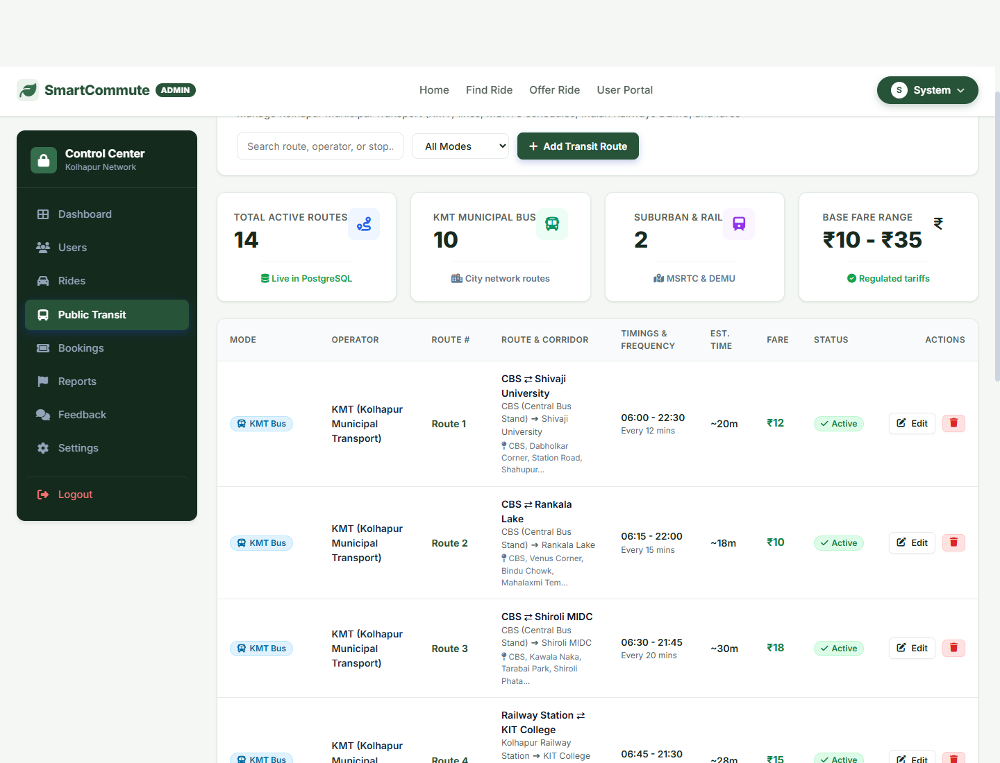
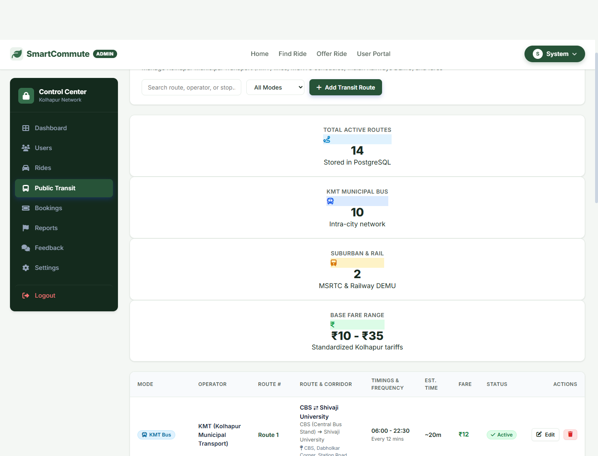
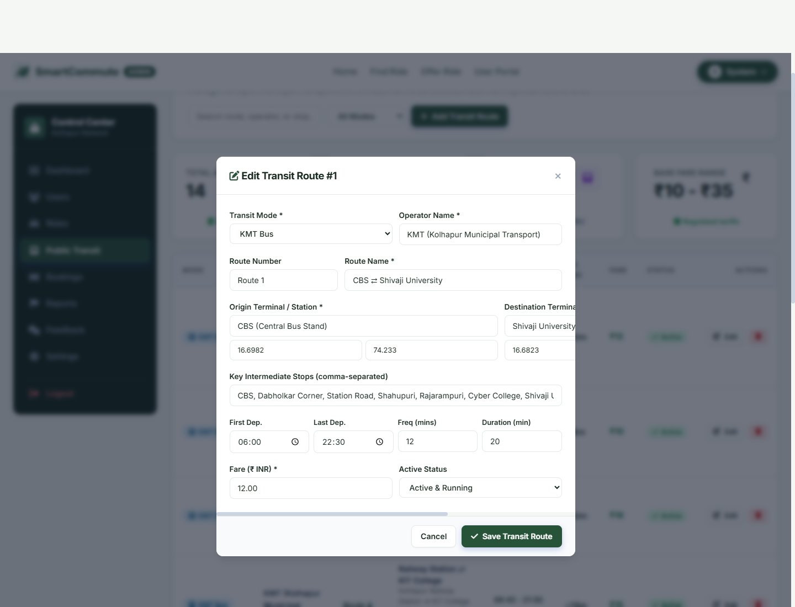
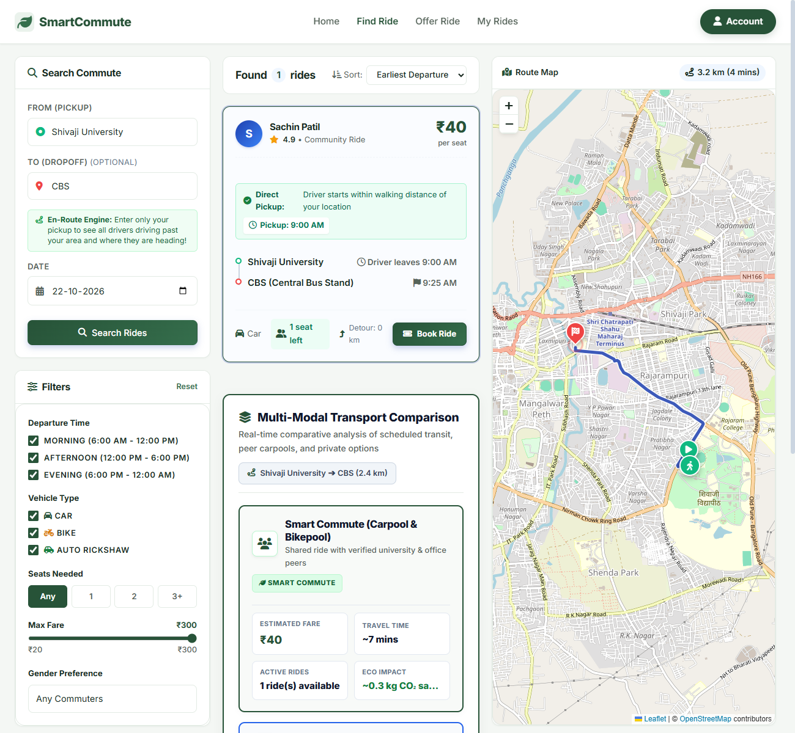
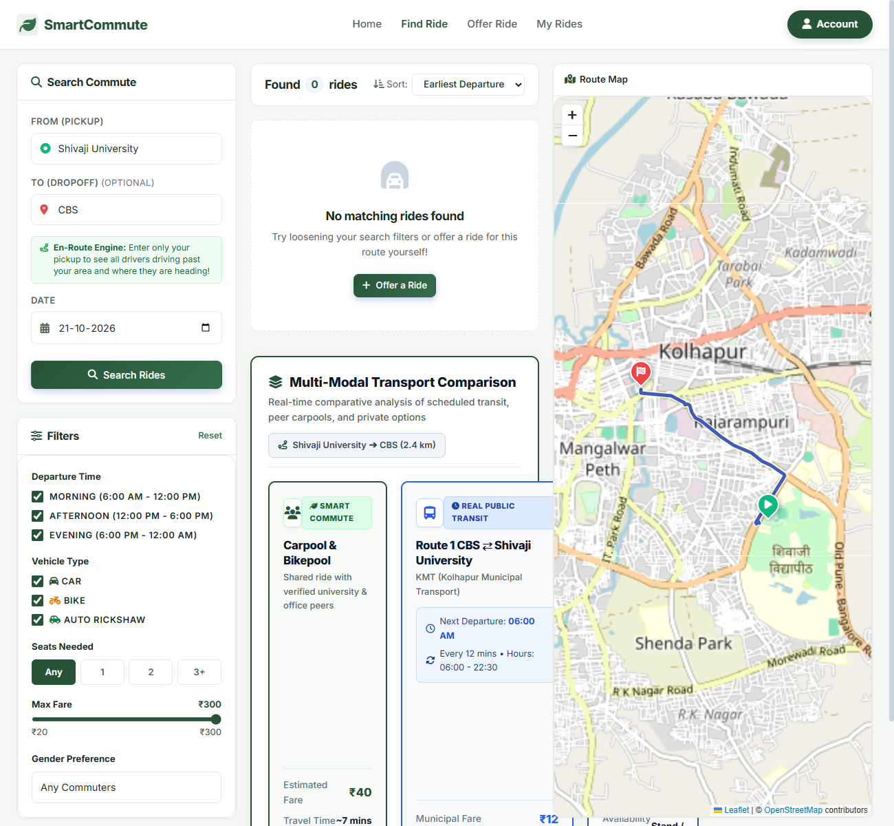
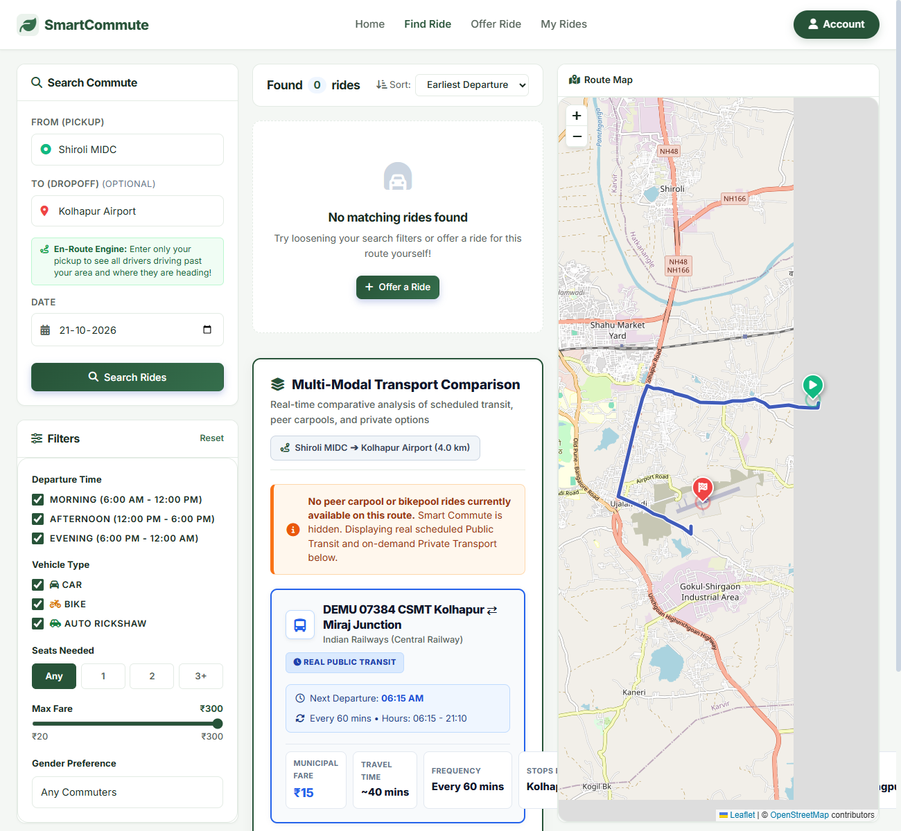

# 🚍 Smart Commute

### Smart Urban Mobility & Transit Comparison Platform

> **Smart Commute** is a web-based transportation platform designed to make everyday commuting simpler by bringing transit information, ride sharing, bookings, and commute-related services together in one place.

The project is built with a **Node.js + Express backend**, database-backed APIs, authentication, transit management, ride/carpool functionality, bookings, feedback, messaging, reports, and an administrative dashboard.

---

## ✨ What is Smart Commute?

Finding the right way to travel often means switching between different platforms to compare public transit, available rides, routes, and costs.

**Smart Commute brings these capabilities together into a single platform.**

Users can interact with transit information, discover available rides, participate in carpooling, manage bookings, and communicate through the platform.

At the same time, administrators can manage transit-related information through a dedicated dashboard.

### 🎯 The goal

**Make daily transportation more connected, accessible, and convenient.**

---

## 🚀 Key Features

### 👤 User Authentication

- User registration and login
- Secure password handling using `bcryptjs`
- JWT-based authentication
- Protected application functionality
- Session/authentication-aware API requests

### 🚗 Ride & Carpool System

- Create and manage rides
- Search for available rides
- Find compatible carpool opportunities
- Handle ride capacity
- Match users with available rides
- Support ride-related communication
- Track ride information

### 🚌 Public Transit

- Transit station information
- Station search
- Transit management APIs
- Transit data administration
- Dedicated admin transit dashboard

### 🎫 Booking Management

- Create bookings
- Manage booking information
- Track ride reservations
- Backend validation for booking operations

### 💬 Communication

- User messaging functionality
- Ride-related communication
- Feedback submission
- Reporting mechanisms

### 📊 Reports & Feedback

- User feedback collection
- Report management
- Backend endpoints for operational monitoring and issue reporting

### 🛠️ Admin Dashboard

Administrators can manage transportation-related information through dedicated administrative functionality.

The repository includes interfaces for:

- Transit dashboard
- Transit management
- Transit editing
- Ride/carpool management workflows

---

## 🖥️ Screenshots

### 🚦 Admin Transit Dashboard



### 🚌 Transit Management



### ✏️ Transit Editing



### 🚗 Available Carpool



### 🤝 Carpool Match



### 🚫 No Available Carpool



---

## 🏗️ System Architecture

```text
                    ┌─────────────────────────┐
                    │       Smart Commute     │
                    │      Web Interface      │
                    └────────────┬────────────┘
                                 │
                                 ▼
                    ┌─────────────────────────┐
                    │     Express.js Server   │
                    │        server.js        │
                    └────────────┬────────────┘
                                 │
          ┌──────────────────────┼──────────────────────┐
          │                      │                      │
          ▼                      ▼                      ▼
   ┌─────────────┐       ┌─────────────┐       ┌─────────────┐
   │ Authentication│       │    Rides    │       │   Transit   │
   │    /auth     │       │   /rides    │       │  /transit   │
   └─────────────┘       └─────────────┘       └─────────────┘
          │                      │                      │
          └──────────────────────┼──────────────────────┘
                                 │
          ┌──────────────────────┼─────────────────────────┐
          │                      │                         │
          ▼                      ▼                         ▼
   ┌─────────────┐       ┌─────────────┐          ┌─────────────┐
   │   Bookings  │       │   Messages  │          │   Feedback  │
   │  /bookings  │       │  /messages  │          │  /feedback  │
   └─────────────┘       └─────────────┘          └─────────────┘
          │                      │                         │
          └──────────────────────┼─────────────────────────┘
                                 ▼
                    ┌─────────────────────────┐
                    │       Database Layer    │
                    │     database/init.js    │
                    └─────────────────────────┘
```

The main Express application serves the frontend from `public/` and mounts separate API route modules for authentication, rides, transit, administration, messaging, bookings, reports, and feedback.

---

## 🧰 Technology Stack

| Layer | Technology |
|---|---|
| Runtime | Node.js |
| Backend | Express.js |
| Database | PostgreSQL |
| Local/Embedded DB Support | better-sqlite3 |
| Authentication | JWT |
| Password Security | bcryptjs |
| Environment Configuration | dotenv |
| API Middleware | CORS |
| Logging | Morgan |
| Development | Nodemon |
| Frontend | Static web application served from `public/` |

The project's `package.json` defines Express, PostgreSQL (`pg`), SQLite support, JWT, bcryptjs, CORS, dotenv, Morgan and Nodemon dependencies.

---

## 📁 Project Structure

```text
smart-commute/
│
├── database/
│   └── init.js                 # Database initialization & data setup
│
├── middleware/                 # Application middleware
│
├── routes/
│   ├── auth.js                 # Authentication APIs
│   ├── rides.js                # Ride & carpool APIs
│   ├── transit.js              # Transit APIs
│   ├── admin.js                # Administrative APIs
│   ├── messages.js             # Messaging APIs
│   ├── bookings.js             # Booking APIs
│   ├── reports.js              # Reporting APIs
│   └── feedback.js             # Feedback APIs
│
├── public/                     # Frontend/static application
│
├── admin_transit_dashboard.png
├── admin_transit_management.png
├── admin_transit_modal_edit.png
├── find_ride_carpool_available.png
├── find_ride_carpool_full.png
├── find_ride_matched_3col.png
├── find_ride_no_carpool.png
│
├── .env.example                # Environment configuration template
├── package.json
├── package-lock.json
├── server.js                   # Main Express server
├── servers.json
├── start.bat                   # Windows startup script
└── test_backend.js             # Backend testing
```

The current repository contains separate route modules for the major platform capabilities, along with database initialization and a static frontend.

---

## ⚙️ How It Works

### 1. User accesses Smart Commute

The frontend is served by the Express server from the `public/` directory.

### 2. Authentication

Users can register/login and receive authenticated access through the platform's authentication system.

### 3. Explore transportation options

The application communicates with backend APIs to retrieve transit and ride information.

### 4. Find a ride

Users can search for available rides and carpool opportunities based on the available ride data.

### 5. Book a ride

When a suitable ride is found, users can create and manage bookings.

### 6. Communicate

Messaging functionality allows users to communicate through the platform.

### 7. Administrative management

Administrators can manage transit information and other platform operations through dedicated APIs and dashboard functionality.

---

## 🔌 API Modules

The backend is organized into dedicated API modules:

| Endpoint | Purpose |
|---|---|
| `/api/auth` | Authentication |
| `/api/rides` | Rides & carpool |
| `/api/transit` | Transit information |
| `/api/admin` | Administration |
| `/api/messages` | Messaging |
| `/api/bookings` | Bookings |
| `/api/reports` | Reports |
| `/api/feedback` | Feedback |
| `/api/stations` | Station listing |
| `/api/stations/search` | Station search |
| `/api/health` | Server health check |

The Express server explicitly mounts these route modules and also provides station and health endpoints.

---

## 🛠️ Installation

### Prerequisites

Make sure you have installed:

- **Node.js**
- **npm**
- **PostgreSQL** if using the PostgreSQL database configuration

### 1. Clone the repository

```bash
git clone https://github.com/harshad-s-desai/smart-commute.git
cd smart-commute
```

### 2. Install dependencies

```bash
npm install
```

### 3. Configure environment variables

Create your `.env` file using the provided template:

```bash
cp .env.example .env
```

On Windows, you can copy the file manually:

```text
.env.example → .env
```

Then configure the required database and application variables.

> ⚠️ Never commit your `.env` file or expose database credentials, JWT secrets, API keys, or other private configuration.

### 4. Start the application

For normal execution:

```bash
npm start
```

For development with automatic restart:

```bash
npm run dev
```

The project is configured to start the Express server on port `3000` by default, unless another `PORT` is specified in the environment.

Open:

```text
http://localhost:3000
```

---

## 🧪 Testing

The repository includes a backend test file:

```text
test_backend.js
```

You can run the project-specific test script according to the test file's implementation/environment.

---

## 🔐 Security

Smart Commute incorporates several backend security practices:

- Password hashing with `bcryptjs`
- JWT-based authentication
- Environment-based configuration
- CORS middleware
- Centralized error handling
- Database-backed operations

The Express application also includes a centralized error handler and API 404 handling.

---

## 🌱 Why Smart Commute?

Smart Commute focuses on more than simply displaying transportation information.

It connects several parts of the commuting experience:

```text
        PUBLIC TRANSIT
              │
              ▼
        ┌─────────────┐
        │             │
RIDES ──►   SMART     ◄── CARPOOL
        │   COMMUTE   │
BOOKING ─►             ◄─ MESSAGING
        │             │
        └──────┬──────┘
               │
               ▼
          BETTER COMMUTE
```

The result is a unified platform where transportation discovery, ride sharing, booking, and communication can work together.

---

## 🔮 Future Scope

The platform can be extended with:

- 📍 Real-time GPS tracking
- 🚦 Live traffic integration
- 🚌 Real-time public transit updates
- 📱 Mobile application
- 🔔 Push notifications
- 💳 Online payment integration
- 🌱 Carbon-emission estimation
- 🗺️ Interactive route visualization
- 🤖 Intelligent route recommendations
- 👥 Advanced carpool matching
- 📊 Advanced commute analytics
- 🔐 Role-based access control improvements

---

## 🤝 Contributing

Contributions are welcome.

### Fork the repository

```bash
git fork https://github.com/harshad-s-desai/smart-commute
```

### Create a feature branch

```bash
git checkout -b feature/your-feature
```

### Commit your changes

```bash
git commit -m "Add your feature"
```

### Push the branch

```bash
git push origin feature/your-feature
```

Then open a Pull Request.

---

## 👨‍💻 Project

**Smart Commute**

A smart mobility platform for improving everyday urban transportation.

**Repository:**  
[github.com/harshad-s-desai/smart-commute](https://github.com/harshad-s-desai/smart-commute?utm_source=chatgpt.com)

---

## ⭐ Support the Project

If you find Smart Commute useful, consider giving the repository a ⭐ on GitHub.

---

<p align="center">
  Made with ❤️ for smarter and more connected commuting.
</p>
